<p align="center">
  
</p>

<p align="center">
  <a href="https://github.com/ishandutta2007/Awesome-Awesome-Awesome"></a>
  <a href="https://discord.gg/jc4xtF58Ve"></a>
  <a href="https://github.com/ishandutta2007/Awesome-Network-Authentication-Radius/stargazers"></a>
  <a href="https://github.com/ishandutta2007/Awesome-Network-Authentication-Radius/network/members"></a>
  <a href="https://github.com/ishandutta2007/Awesome-Network-Authentication-Radius/blob/main/LICENSE"></a>
  <a href="https://github.com/ishandutta2007/Awesome-Network-Authentication-Radius/issues"></a>
  <a href="https://github.com/ishandutta2007/Awesome-Network-Authentication-Radius/pulls"></a>
  <a href="https://github.com/ishandutta2007/Awesome-Network-Authentication-Radius/commits/main"></a>
  <a href="https://github.com/ishandutta2007"></a>
</p>

---

# 🛡️ Awesome Network Authentication & RADIUS Ecosystem 🌐

> A curated directory of production-grade **AAA (Authentication, Authorization, and Accounting)** platforms, **802.1X / EAP** engines, **Network Access Control (NAC)** solutions, and **Cloud RADIUS / RadSec** services.

Whether you are configuring enterprise Wi-Fi (WPA2/WPA3-Enterprise), authenticating VPN tunnels, enforcing device micro-segmentation, securing dynamic VLAN assignment, or building carrier-grade ISP subscriber accounting, this directory lists both enterprise-grade SaaS platforms and open-source software.

---

## 📑 Table of Contents

- [📊 Sector Overview & Market Dynamics](#-sector-overview--market-dynamics)
- [☁️ SaaS & Hosted Network Authentication Platforms](#️-saas--hosted-network-authentication-platforms)
- [💻 Open-Source GitHub Projects](#-open-source-github-projects)
- [🔐 Core Protocols & Authentication Standards](#-core-protocols--authentication-standards)
- [🤝 How to Contribute](#-how-to-contribute)
- [📈 Star History](#-star-history)
- [💖 Support & Sponsoring](#-support--sponsoring)
- [📜 Disclaimer & License](#-disclaimer--license)

---

## 📊 Sector Overview & Market Dynamics

The global **Network Access Control (NAC) and AAA/RADIUS Authentication** market was valued at **$3.24 billion in 2024** and is projected to expand to **$7.86 billion by 2030**, reflecting a Compound Annual Growth Rate (**CAGR of 15.9%**). Growth is catalyzed by zero-trust architecture mandates, rapid adoption of 802.1X certificate-based (EAP-TLS) passwordless authentication, IoT device explosion on corporate LANs, and hybrid workforces requiring dynamic access control.

In terms of industry concentration, the market is **moderately concentrated with a bifurcated dynamic**:
- **Legacy Enterprise Core (Concentrated Oligopoly)**: Traditional on-premise campus networking is dominated by a few multi-billion dollar incumbents—most notably **Microsoft (NPS)**, **Cisco (ISE)**, and **HPE Aruba (ClearPass)**—who command high switching costs and deep proprietary networking integration.
- **Cloud-Native & Open-Source Edge (Fragmented Challenger Wave)**: Rapid fragmentation is taking place in the cloud-native RADIUS and identity-provider integration layer. Specialized SaaS players like **JumpCloud**, **Portnox**, **Foxpass**, and **SecureW2** are disaggregating legacy appliances with zero-infrastructure models, while **FreeRADIUS** and **PacketFence** underpin over 35% of the world's carrier, university (eduroam), and ISP AAA backbones.

---

## ☁️ SaaS & Hosted Network Authentication Platforms

The following SaaS and commercial enterprise platforms provide hosted or hybrid AAA, Cloud RADIUS (RFC 2865 / RFC 6614 RadSec), and Network Access Control. Entries are **sorted descending by company size (market valuation / annual revenue)**.

| 🏢 Platform | 💰 Company Size (Valuation / Revenue) | 🏷️ Starting Tier Pricing | 🎁 Free Tier / Trial Limits | 🔑 Protocols & Key Features | 🎯 Best Fit & Use Cases |
| :--- | :--- | :--- | :--- | :--- | :--- |
| **[Microsoft NPS (Network Policy Server)](https://learn.microsoft.com/en-us/windows-server/networking/technologies/nps/nps-top)** | **$3.12 Trillion** Market Cap<br>*(FY24 Revenue: $245.1B)* | **$501.00** one-time (Windows Server Essentials, up to 25 users / 50 devices) or **$1,069.00** (Standard 16-core) + **$44.00/user** CAL | **180-day free evaluation trial**<br>*(Full Windows Server evaluation image with 100% unrestricted RADIUS & NPS features)* | RADIUS (RFC 2865/2866), Active Directory Domain Services (AD DS) SSO, 802.1X PEAP-MSCHAPv2, EAP-TLS, NPS Proxy | Windows-centric on-premises enterprise environments running Active Directory Domain Services. |
| **[Cisco Identity Services Engine (ISE)](https://www.cisco.com/site/us/en/products/security/identity-services-engine/index.html)** | **$230.5 Billion** Market Cap<br>*(FY24 Revenue: $53.8B)* | **$4.50 per endpoint/year** (ISE Essentials tier, min. 100 endpoints = **$450.00/year**; Base VM license starts at **$2,500.00**) | **90-day free trial**<br>*(Full evaluation license for up to 100 concurrent endpoints on Cisco dCloud or virtual appliance)* | Enterprise NAC, RADIUS, TACACS+, TrustSec SGT micro-segmentation, 802.1X (EAP-TLS, PEAPv0/v1, EAP-FAST), Posture check | Large enterprises, hospitals, and financial institutions standardized on Cisco switching, routing, and Meraki Wi-Fi. |
| **[Aruba ClearPass Policy Manager](https://www.arubanetworks.com/products/security/network-access-control/)** | **$27.8 Billion** Market Cap *(HPE)<br>*(FY24 Revenue: $29.1B)* | **$3.50 per endpoint/year** (ClearPass Entry subscription) or **$28.00 per endpoint perpetual** (NL license; base VM at **$2,100.00**) | **90-day free trial**<br>*(Virtual appliance evaluation image supporting up to 500 concurrent devices with full policy features)* | Multi-vendor NAC, RADIUS, TACACS+, OnConnect enforcement, dynamic role-based micro-segmentation, automated threat isolation | Multi-vendor campus networks requiring granular context-based policy mapping and automated threat quarantine. |
| **[JumpCloud Cloud RADIUS](https://jumpCloud.com/platform/cloud-radius)** | **$2.60 Billion** Valuation<br>*(Annual Recurring Revenue: ~$120M)* | **$9.00 per user/month** (JumpCloud Core package, includes Cloud RADIUS, Cloud Directory, SSO, and MFA; billed annually) | **30-day full-featured free trial**<br>*(Full platform access with unlimited RADIUS authentications; legacy accounts hold free 10 users/10 devices)* | Cloud RADIUS-as-a-Service, automated shared secrets, delegated Entra ID / Google sync, dynamic VLAN tagging, Wi-Fi MFA | Cloud-first companies and hybrid teams wanting directory-backed 802.1X Wi-Fi/VPN authentication without hardware. |
| **[Splashtop Foxpass](https://www.foxpass.com/)** | **$1.00 Billion** Valuation *(Splashtop)<br>*(Annual Revenue: ~$75M+)* | **$2.00 per user/month** (Standard Cloud RADIUS & LDAP tier, billed annually; or **$150.00/month** base team tier) | **30-day free trial**<br>*(Up to 10 users with full Cloud RADIUS, RadSec, LDAP, and Google Workspace / Okta sync; no credit card)* | RadSec (RFC 6614 RADIUS over TLS) enforced by default, Delegated Cloud LDAP/RADIUS, Google Workspace/Okta/Azure AD sync | Security-conscious tech startups, DevOps teams, and companies requiring RadSec-by-default with fast API integration. |
| **[Portnox Cloud](https://www.portnox.com/)** | **~$100 Million** Valuation<br>*(Series A: $22M; Revenue: ~$15M)* | **£0.81 (~$1.05) per device/month** (UK G-Cloud framework) / **$2.00 per device/month** (Base tier, min. 100 devices = **$2,400.00/year**) | **30-day free trial**<br>*(Up to 100 endpoints with complete Cloud RADIUS, RadSec proxy, TACACS+, and local 7-day outage cache)* | 100% Cloud-native RADIUS & TACACS+, RadSec over mTLS, local edge caching proxy with 7-day outage survivability, ZTNA | Mid-market enterprises seeking zero-maintenance cloud RADIUS with resilience against local internet outages. |
| **[SecureW2 JoinNow](https://www.securew2.com/)** | **~$50 Million** Valuation<br>*(Bootstrapped; Revenue: ~$20M)* | **$5.00 per device/year** (Billed annually, minimum 100 devices = **$3,000.00/year** base contract minimum) | **30-day guided PoC sandbox trial**<br>*(Full PKI & Cloud RADIUS sandbox coordinated via engineer-assisted onboarding for up to 50 test devices)* | Cloud RADIUS with Managed Cloud PKI, automated SCEP / ACME certificate enrollment, passwordless 802.1X EAP-TLS onboarding | Organizations eliminating password-based Wi-Fi via automated certificate enrollment with Intune, Jamf, and MDM systems. |
| **[IronWiFi](https://www.ironwifi.com/)** | **~$15 Million** Valuation<br>*(Bootstrapped; Revenue: ~$4.5M)* | **$45.00 per month** (Bronze Plan: up to 100 concurrent devices, 1,000 guest accounts, and 1 RADIUS server location) | **14-day free trial**<br>*(Up to 5 concurrent devices and 100 guest accounts with standard RADIUS and captive portal support)* | Hosted RADIUS, guest Wi-Fi captive portals, SMS/social login verification, multi-region failover, Stripe payment billing | Hospitality, retail chains, coworking spaces, and SMBs requiring combined 802.1X and guest captive portal authentication. |

---

## 💻 Open-Source GitHub Projects

These open-source projects provide production-ready RADIUS daemons, TACACS+ access controllers, web administration interfaces, and protocol libraries. 

Entries are **sorted descending by GitHub star count** ⭐.

---

### 1. [FreeRADIUS](https://github.com/FreeRADIUS/freeradius-server) [](https://github.com/FreeRADIUS/freeradius-server/stargazers)
- **Repository**: [`FreeRADIUS/freeradius-server`](https://github.com/FreeRADIUS/freeradius-server)
- **Primary Language**: C | **License**: GPL-2.0
- **Overview**: The undisputed reference implementation of RADIUS and the most widely deployed AAA server on Earth. Authenticates approximately one-third of all global internet traffic, forms the core backbone of the **eduroam** global roaming network, and scales to tens of millions of concurrent subscribers in national tier-1 telecom and ISP architectures.
- **Key Features**:
  - Multi-protocol policy engine implementing RADIUS (RFC 2865/2866), RadSec (RFC 6614), DHCP, BFD, and ARP.
  - Complete EAP suite: EAP-TLS, EAP-TTLS, PEAP, EAP-MSCHAPv2, EAP-SIM, and EAP-AKA.
  - Pluggable backends: PostgreSQL, MySQL, OpenLDAP, Active Directory, Redis, SQLite, REST API (`rlm_rest`), and Perl/Python script hooks.
  - Highly expressive, Turing-complete policy configuration language (`unlang`).

---

### 2. [PacketFence](https://github.com/inverse-inc/packetfence) [](https://github.com/inverse-inc/packetfence/stargazers)
- **Repository**: [`inverse-inc/packetfence`](https://github.com/inverse-inc/packetfence)
- **Primary Language**: Perl / JavaScript | **License**: GPL-2.0
- **Overview**: Enterprise-grade Free and Open Source Network Access Control (NAC) system trusted worldwide. Delivers comprehensive network security enforcement for heterogeneous wired and wireless multivendor infrastructure.
- **Key Features**:
  - Built-in RADIUS server and captive portal engine for guest onboarding and self-registration.
  - Dynamic VLAN assignment, role-based micro-segmentation, and 802.1X EAP authentication.
  - Comprehensive BYOD workflows with automated MDM integration (Intune, Jamf).
  - Layer-2 isolation (inline, VLAN steering, and SNMP/CoA disconnection) for compromised devices.

---

### 3. [daloRADIUS](https://github.com/lirantal/daloradius) [](https://github.com/lirantal/daloradius/stargazers)
- **Repository**: [`lirantal/daloradius`](https://github.com/lirantal/daloradius)
- **Primary Language**: PHP / JavaScript | **License**: GPL-2.0
- **Overview**: Popular web administration platform designed specifically for managing FreeRADIUS instances, internet service provider deployments, and Wi-Fi hotspot operators.
- **Key Features**:
  - Intuitive web GUI for subscriber provisioning, password resets, and user group management.
  - Rich accounting, session monitoring, bandwidth tracking, and data quota enforcement.
  - Integrated billing engine supporting pre-paid vouchers, PayPal, invoices, and rate plans.
  - Visual GIS mapping integration via OpenStreetMap to locate network access points and hotspots.

---

### 4. [ToughRADIUS](https://github.com/talkincode/toughradius) [](https://github.com/talkincode/toughradius/stargazers)
- **Repository**: [`talkincode/toughradius`](https://github.com/talkincode/toughradius)
- **Primary Language**: Go / TypeScript | **License**: Apache-2.0
- **Overview**: High-performance, modern RADIUS server engineered in Golang for ISPs, enterprise intranets, and carriers. Features a built-in React Admin web management console and native Docker deployment.
- **Key Features**:
  - Full support for RFC 2865 standard RADIUS, RadSec (TLS over TCP), and 802.1X protocols.
  - Comprehensive EAP authentication: EAP-MD5, EAP-MSCHAPv2, EAP-TLS, PEAPv0, and EAP-TTLS.
  - Native multi-vendor Vendor-Specific Attributes (VSA) for MikroTik, Cisco, Huawei, and H3C.
  - PostgreSQL and SQLite database backends with real-time session tracking and CoA disconnect.

---

### 5. [OpenWISP RADIUS](https://github.com/openwisp/openwisp-radius) [](https://github.com/openwisp/openwisp-radius/stargazers)
- **Repository**: [`openwisp/openwisp-radius`](https://github.com/openwisp/openwisp-radius)
- **Primary Language**: Python | **License**: GPL-3.0
- **Overview**: Modular Django application providing a centralized administration web UI and RESTful API for FreeRADIUS 3. Designed for public Wi-Fi networks, university campuses, and municipal hotspot networks.
- **Key Features**:
  - REST API interface interfacing directly with FreeRADIUS via `rlm_rest`.
  - Captive portal user management, self-registration via SMS/email tokens, and social login OAuth integration.
  - WPA-Enterprise 802.1X user credential handling and Hotspot 2.0 (Passpoint / 802.11u) profile management.
  - Batch user importing, usage accounting limits, and organizational multi-tenancy.

---

### 6. [pyrad](https://github.com/pyradius/pyrad) [](https://github.com/pyradius/pyrad/stargazers)
- **Repository**: [`pyradius/pyrad`](https://github.com/pyradius/pyrad)
- **Primary Language**: Python | **License**: BSD-3-Clause
- **Overview**: The standard Python library implementing RADIUS client and server capabilities in pure Python (RFC 2865 and RFC 2866). Widely used for automated testing, custom proxy daemons, and microservices.
- **Key Features**:
  - Fully implements RADIUS packet decoding, encoding, signing, and verification.
  - Supports custom and standard RADIUS dictionary files.
  - Native packet handling for Access-Request, Access-Accept, Access-Reject, and Accounting-Request packets.
  - Lightweight and dependency-free, making it ideal for integration into Python web applications and automated QA pipelines.

---

### 7. [Keycloak RADIUS Plugin](https://github.com/vzakharchenko/keycloak-radius-plugin) [](https://github.com/vzakharchenko/keycloak-radius-plugin/stargazers)
- **Repository**: [`vzakharchenko/keycloak-radius-plugin`](https://github.com/vzakharchenko/keycloak-radius-plugin)
- **Primary Language**: Java | **License**: Apache-2.0
- **Overview**: Seamlessly embeds a native RADIUS server inside Red Hat Keycloak, allowing network access devices (firewalls, VPN gateways, Wi-Fi controllers) to authenticate against Keycloak's IAM core.
- **Key Features**:
  - Bridges RADIUS authentication directly to Keycloak user realms and federated identity pools.
  - Supports OTP / TOTP multi-factor authentication (MFA) over RADIUS for Cisco, Fortinet, and Palo Alto VPNs.
  - Supports PAP, CHAP, MS-CHAPv2, and Mikrotik dictionary attributes.
  - Enables unified Single Sign-On (SSO) governance across web apps and corporate network infrastructure.

---

### 8. [tac_plus](https://github.com/facebook/tac_plus) [](https://github.com/facebook/tac_plus/stargazers)
- **Repository**: [`facebook/tac_plus`](https://github.com/facebook/tac_plus)
- **Primary Language**: C | **License**: BSD-3-Clause
- **Overview**: Facebook / Meta's hardened TACACS+ daemon designed for enterprise network device administration, automated configuration auditing, and command-level authorization.
- **Key Features**:
  - Strict separation of Authentication, Authorization, and Accounting for network equipment (Cisco, Arista, Juniper).
  - Robust IPv4 and IPv6 support tested across hyperscale datacenter fabrics.
  - Granular per-command authorization rules enforcing least-privilege network operations.
  - Centralized accounting logs recording exact CLI commands executed by network engineers.

---

### 9. [Tacquito](https://github.com/facebookincubator/tacquito) [](https://github.com/facebookincubator/tacquito/stargazers)
- **Repository**: [`facebookincubator/tacquito`](https://github.com/facebookincubator/tacquito)
- **Primary Language**: Go | **License**: MIT
- **Overview**: A modern, high-throughput TACACS+ server and client library built in Go by Meta engineers, fully conforming to RFC 8907.
- **Key Features**:
  - Native RFC 8907 compliance with full support for TACACS+ single-connect mode.
  - High concurrency designed to handle bursts of concurrent router/switch configuration sessions.
  - Pluggable backend architecture allowing custom authn/authz logic against modern corporate identity providers.
  - Clean modular Go codebase suitable for embedding in custom network telemetry agents.

---

### 10. [FreeRADIUS Client](https://github.com/FreeRADIUS/freeradius-client) [](https://github.com/FreeRADIUS/freeradius-client/stargazers)
- **Repository**: [`FreeRADIUS/freeradius-client`](https://github.com/FreeRADIUS/freeradius-client)
- **Primary Language**: C | **License**: BSD-2-Clause
- **Overview**: The official portable C library for building RADIUS client software (formerly known as `radiusclient-ng`).
- **Key Features**:
  - Provides a clean C API for authenticating users and submitting accounting records to remote RADIUS servers.
  - Ships with `radlogin` and `radstatus` utilities for CLI querying and network diagnostics.
  - Supports standard RADIUS RFCs, vendor attribute parsing, and IP routing table integration.
  - BSD licensed, allowing seamless linkage into commercial and open-source applications alike.

---

### 11. [radius-rs](https://github.com/moznion/radius-rs) [](https://github.com/moznion/radius-rs/stargazers)
- **Repository**: [`moznion/radius-rs`](https://github.com/moznion/radius-rs)
- **Primary Language**: Rust | **License**: MIT / Apache-2.0
- **Overview**: Native asynchronous RADIUS server and client framework written in Rust using Tokio.
- **Key Features**:
  - Memory-safe, zero-cost abstraction RADIUS protocol parser and serializer.
  - Fully asynchronous request handling powered by Tokio UDP networking.
  - Comprehensive support for standard attribute dictionary generation and custom VSA encoding.
  - Excellent foundation for developing lightweight, containerized micro-RADIUS proxies.

---

### 12. [google-apps-radius](https://github.com/layeh/google-apps-radius) [](https://github.com/layeh/google-apps-radius/stargazers)
- **Repository**: [`layeh/google-apps-radius`](https://github.com/layeh/google-apps-radius)
- **Primary Language**: Go | **License**: MIT
- **Overview**: Specialized RADIUS server that authenticates incoming user credentials directly against Google Workspace (formerly Google Apps / G Suite) domains.
- **Key Features**:
  - Bridges legacy RADIUS network gear (access points, VPN concentrators) to Google Workspace identity.
  - Directly authenticates credentials via Google APIs or Google Secure LDAP service.
  - Single binary deployment with minimal memory footprint and zero external database dependency.
  - Ideal for small businesses and co-working offices relying entirely on Google Workspace accounts.

---

### 13. [eradius](https://github.com/travelping/eradius) [](https://github.com/travelping/eradius)
- **Repository**: [`travelping/eradius`](https://github.com/travelping/eradius)
- **Primary Language**: Erlang | **License**: BSD-3-Clause
- **Overview**: Highly resilient Erlang framework for developing carrier-class RADIUS applications, proxies, and accounting handlers.
- **Key Features**:
  - Built on OTP actor principles for fault-tolerant, high-throughput packet processing.
  - Hot code reloading and dynamic dictionary compilation without daemon downtime.
  - Extensively deployed in telecommunication core networks, GPRS/LTE data gateways, and SS7/Diameter bridges.
  - Native support for RADIUS proxying, load balancing, and packet manipulation pipelines.

---

### 14. [Taranac](https://github.com/TaranacLabs/taranac) [](https://github.com/TaranacLabs/taranac/stargazers)
- **Repository**: [`TaranacLabs/taranac`](https://github.com/TaranacLabs/taranac)
- **Primary Language**: Go / TypeScript | **License**: Apache-2.0
- **Overview**: Next-generation unified open-source Network Access Control platform bringing TACACS+, RADIUS, and 802.1X into a single policy core.
- **Key Features**:
  - Unified administration console for both device administration (TACACS+) and end-user access (RADIUS).
  - Modern Web UI with real-time audit event logging and session visualization.
  - Built for cloud-native deployment with Kubernetes helm charts and container images.
  - Granular role-based authorization engine with multi-tenant domain partitioning.

---

## 🔐 Core Protocols & Authentication Standards

Understanding the differences between AAA protocols is critical for choosing the right infrastructure:

```
+---------------------------------------------------------------------------------------------------+
|                                 ENTERPRISE AAA PROTOCOL STACK                                      |
+---------------------------------------------------------------------------------------------------+
|  [ Endpoints / Clients ]   ---> (EAP-TLS / PEAP / 802.1X)  --->  [ Authenticator (Switch / AP) ]  |
|  [ Authenticator ]        ---> (RADIUS / RadSec / TACACS+) --->  [ AAA Server (FreeRADIUS / ISE) ]|
|  [ AAA Server ]           ---> (LDAP / SAML / OIDC / PKI)  --->  [ Identity Provider / CA ]       |
+---------------------------------------------------------------------------------------------------+
```

### 1. Protocol Comparison Matrix

| Protocol | Transport | Port | RFC | Security Highlights | Primary Use Case |
| :--- | :--- | :--- | :--- | :--- | :--- |
| **RADIUS** | UDP | 1812 (Auth), 1813 (Acct) | RFC 2865, 2866 | MD5 shared secret hash (vulnerable to offline brute force) | Network access, Wi-Fi 802.1X, VPN login |
| **RadSec** | TCP / TLS | 2083 | RFC 6614 | Full mutual TLS (mTLS) encryption, reliable TCP delivery | Cloud RADIUS, cross-WAN roaming (eduroam) |
| **TACACS+**| TCP | 49 | RFC 8907 | Entire packet encrypted, separate AuthN / AuthZ / Acct | Router / switch CLI admin access |
| **Diameter**| TCP / SCTP | 3868 | RFC 6733 | Native failover, peer discovery, 32-bit AVPs | 4G/5G mobile packet cores, IMS |

### 2. Common 802.1X EAP Authentication Methods

- **EAP-TLS (RFC 5216)**: **Gold Standard.** Mutual certificate authentication. The client validates the server's TLS certificate, and the server validates the client's certificate. Eliminates passwords completely and prevents credential harvesting.
- **PEAPv0 / EAP-MSCHAPv2**: Common enterprise legacy method. The server presents a certificate, creating an encrypted tunnel through which username/password are sent. Susceptible to rogue AP attacks if client trust settings are misconfigured.
- **EAP-TTLS (RFC 5281)**: Similar to PEAP, but can tunnel non-MSCHAP authentication protocols (such as PAP or inner EAP methods) inside a secure TLS tunnel.

---

## 🤝 How to Contribute

Contributions to keep this ecosystem directory comprehensive, fresh, and accurate are welcome!

1. 🍴 **Fork the repository** on GitHub.
2. 🌿 **Create a new branch**: `git checkout -b add/new-radius-platform`.
3. 📝 **Add your entry**: Ensure you follow the existing format:
   - For SaaS tools: Include specific starting tier pricing, explicit free trial days/limits, and company size.
   - For Open-Source projects: Include star badges linked to stargazers and sorted in descending order.
4. 🚀 **Commit your changes**: `git commit -m "Add New-Radius-Tool to open-source tools"`.
5. 📬 **Submit a Pull Request** with a brief summary of why the tool belongs in this curated directory.

---

## 📈 Star History

[](https://star-history.dera.page/#ishandutta2007/Awesome-Network-Authentication-Radius&type=date&legend=top-left)

---

## 💖 Support & Sponsoring

Thank you for visiting and supporting this curated resource! If this repository assisted you in architecting, auditing, or deploying network authentication infrastructure:

- ⭐ **Star this repository** to improve visibility for network engineers and sysadmins worldwide.
- 🍴 **Fork and share** with colleagues in network operations, cybersecurity, and DevOps.
- 💬 **Join our Discord** at [discord.gg/jc4xtF58Ve](https://discord.gg/jc4xtF58Ve) to discuss network architecture and authentication.
- ☕ **Support the maintainer**: You can sponsor ongoing open-source curation and tool evaluation via the [GitHub Sponsors Dashboard](https://github.com/sponsors/ishandutta2007).

---

## 📜 Disclaimer & License

- **Disclaimer**: This repository is a community-curated directory compiled for educational and architectural evaluation purposes. Brand names, logos, and trademarks belong to their respective owners. Mention of SaaS or commercial offerings does not constitute an endorsement.
- **License**: Released under the [MIT License](LICENSE).
